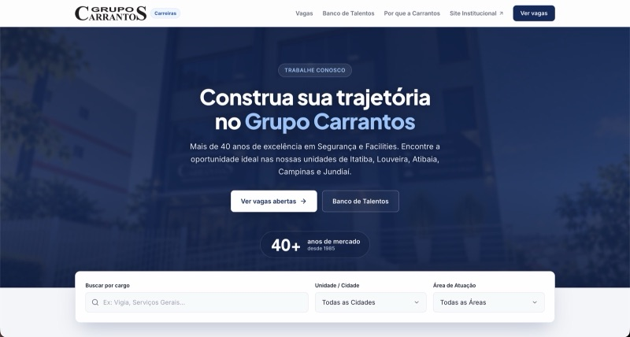
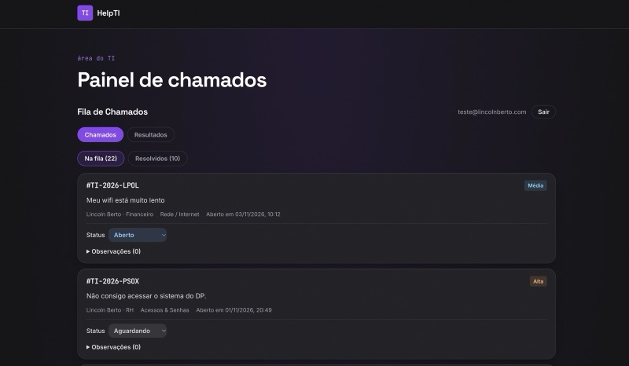
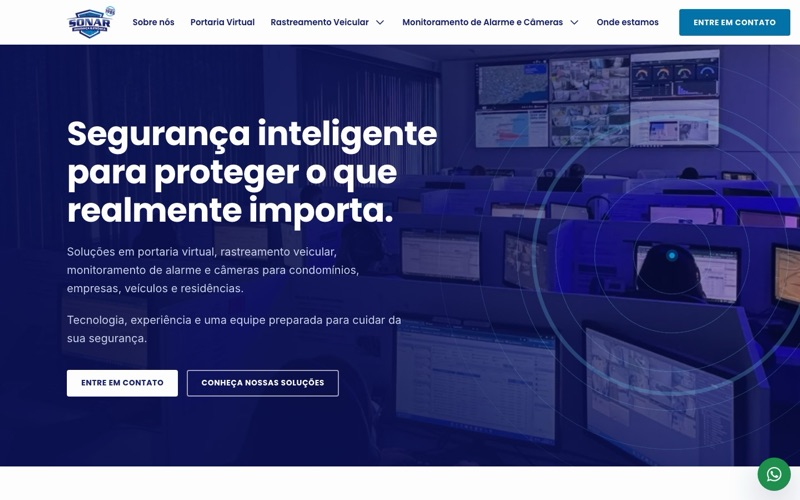
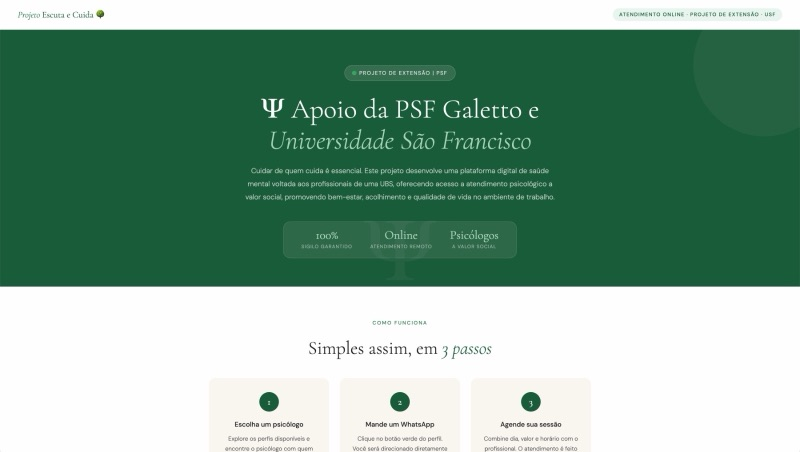

<a href="https://www.lincolnberto.com">
  
</a>

<p align="center">
  <a href="https://www.lincolnberto.com"></a>
  <a href="https://www.linkedin.com/in/lincoln-berto/"></a>
  <a href="mailto:contato@lincolnberto.com"></a>
</p>

## 👋 Sobre mim

Construo sistemas que pessoas usam todo dia. Sou o responsável técnico de TI do **Grupo Carrantos**, onde criei do zero o portal de vagas que o RH usa em todos os processos seletivos e a central de chamados de TI da empresa. Também desenvolvo sites para clientes pela **Berto Codes**.

Antes do código, foram mais de seis anos de atendimento e suporte. Por isso eu começo entendendo a rotina de quem vai usar o sistema, e só depois escrevo código.

```
2014 Correios → 2017 Varejo → 2019 Administrativo USF → 2023 Suporte de TI → 2025 Responsável de TI + Dev → 2026 Berto Codes
```

🎯 Procuro uma vaga de **desenvolvedor front-end**, remota ou na região de Campinas.

## 🚀 Projetos em produção

<table>
  <tr>
    <td width="50%" valign="top">
      <a href="https://www.lincolnberto.com/projetos/ats-carrantos/"></a>
      <h3>Carrantos Vagas</h3>
      <p>Portal de vagas e triagem de candidatos que substituiu as plataformas externas do RH. Tem área administrativa com permissões, upload de currículos e Row Level Security no banco.</p>
      <p><b>+20 vagas · +50 candidatos · usado em todos os processos seletivos</b></p>
      <p><code>React</code> <code>TypeScript</code> <code>Supabase</code> <code>PostgreSQL</code></p>
      <p><a href="https://vagas.carrantos.com.br">Ver no ar</a> · <a href="https://github.com/eilincoln/carrantos-vagas">Código</a> · <a href="https://www.lincolnberto.com/projetos/ats-carrantos/">Case</a></p>
    </td>
    <td width="50%" valign="top">
      <a href="https://www.lincolnberto.com/projetos/help-ti/"></a>
      <h3>Help TI</h3>
      <p>Central de chamados que tirou os pedidos de TI do WhatsApp. O colaborador abre o chamado sem login, recebe um protocolo e acompanha o status; o técnico atende a fila num painel fechado.</p>
      <p><b>0 logins para abrir chamado · proteção contra força bruta</b></p>
      <p><code>React</code> <code>TypeScript</code> <code>Supabase</code> <code>PostgreSQL</code></p>
      <p><a href="https://youtu.be/eemmh7O4N1Y">Vídeo</a> · <a href="https://github.com/eilincoln/help-ti">Código</a> · <a href="https://www.lincolnberto.com/projetos/help-ti/">Case</a></p>
    </td>
  </tr>
  <tr>
    <td width="50%" valign="top">
      <a href="https://sonarseg.com.br"></a>
      <h3>Sonar Segurança Eletrônica</h3>
      <p>Site institucional do meu primeiro cliente pela Berto Codes, com uma página para cada solução e público. Fiz do layout à publicação.</p>
      <p><b>10 páginas · contraste AA · 1ª nota fiscal emitida</b></p>
      <p><code>HTML</code> <code>CSS</code> <code>JavaScript</code></p>
      <p><a href="https://sonarseg.com.br">Ver no ar</a> · <a href="https://www.lincolnberto.com/projetos/sonar/">Case</a></p>
    </td>
    <td width="50%" valign="top">
      <a href="https://www.lincolnberto.com/projetos/escuta-e-cuida/"></a>
      <h3>Escuta e Cuida</h3>
      <p>Projeto social com o curso de Psicologia da USF e a PSF Jardim Galetto: os profissionais da unidade de saúde encontram um psicólogo e marcam atendimento pelo WhatsApp.</p>
      <p><b>8 psicólogos · 0 cadastros · nenhum dado guardado</b></p>
      <p><code>HTML</code> <code>CSS</code> <code>JavaScript</code></p>
      <p><a href="https://github.com/eilincoln/projeto-escuta-e-cuida">Código</a> · <a href="https://www.lincolnberto.com/projetos/escuta-e-cuida/">Case</a></p>
    </td>
  </tr>
</table>

## 🛠️ Tecnologias

<p>
  
  <br/>
  
</p>

## 🧭 Como eu trabalho

| 👂 Ouço antes de resolver | 🚢 Coloco no ar e fico por perto | 💬 Explico sem complicar |
|---|---|---|
| O problema que a pessoa descreve nem sempre é o que precisa ser resolvido. Primeiro eu entendo a rotina de quem vai usar. | Sistema bom é sistema em uso. Publico, confiro cada página e continuo disponível depois da entrega. | Do RH ao cliente, escrevo em português claro: documentação, instruções e passo a passo. |

## 🥋 Fora do código

Treino jiu-jitsu (o tatame ensina paciência, igual a um bug difícil), leio bastante e estou estudando inglês.

---

<p align="center">
  <b>Vamos conversar?</b><br/>
  <a href="mailto:contato@lincolnberto.com">contato@lincolnberto.com</a> · <a href="https://www.lincolnberto.com">lincolnberto.com</a> · <a href="https://www.linkedin.com/in/lincoln-berto/">LinkedIn</a>
</p>
